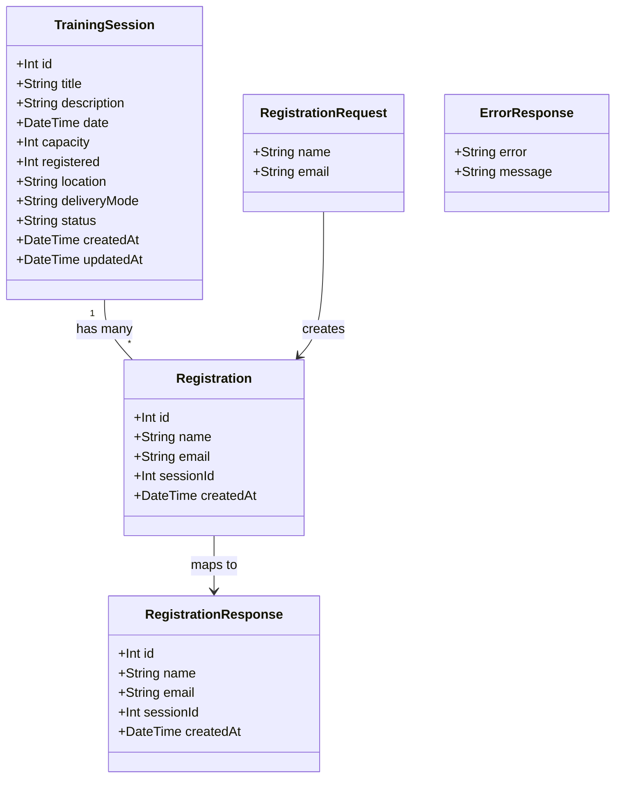

# Employee Training Session Registration

## Requirements

Implement employee registration for available training sessions, enabling employees to submit their name and email to secure a place. The system must validate session availability, prevent over-capacity registrations, and provide appropriate feedback for success and failure scenarios.

## Entities

## Approach

1. **API Design**:
   - RESTful endpoint following existing Express router patterns
   - `POST /api/training-sessions/:id/registrations` accepting JSON body `{ name, email }`
   - Return HTTP 201 with registration details on success
   - Return HTTP 400 for missing required fields
   - Return HTTP 404 for non-existent session
   - Return HTTP 409 for full session

2. **Data Persistence**:
   - Add `Registration` model to Prisma schema with SQLite
   - Maintain denormalized `registered` counter on `TrainingSession` for O(1) capacity checks
   - Use Prisma interactive transactions for atomic registration creation and count increment

3. **Concurrency Control**:
   - Use atomic conditional update: `UPDATE training_sessions SET registered = registered + 1 WHERE id = ? AND registered < capacity`
   - Check affected rows to determine if registration succeeded or session is full
   - Prevents race conditions when multiple employees register simultaneously

4. **Frontend Integration**:
   - Add registration form to `TrainingSessionCard` component
   - Disable/hide form when `registered >= capacity`
   - Display confirmation message on successful registration
   - Update local state to reflect new registered count

## Structure

### Inheritance Relationships
1. `Registration` model extends Prisma base model
2. `ErrorResponse` interface defines standard error response shape

### Dependencies
1. `training-sessions.ts` route depends on `registrationService`
2. `registrationService` depends on `prisma` client
3. `TrainingSessionCard` component depends on API endpoint for registration

### Layered Architecture
1. **Route Layer** (`api/src/routes/training-sessions.ts`): HTTP request handling, status code mapping
2. **Service Layer** (`api/src/services/registrationService.ts`): Business logic, validation, transaction management
3. **Data Access Layer** (`api/src/lib/prisma.ts`): Prisma client for database operations
4. **Frontend Component Layer** (`app/src/components/TrainingSessionCard.tsx`): UI form, state management, API calls

## Operations

### Update Prisma Schema - Add Registration Model
1. Responsibility: Define the Registration database model
2. Attributes:
   - id: Int - Auto-increment primary key
   - name: String - Employee name (required, max 255 chars)
   - email: String - Employee email (required, max 255 chars)
   - sessionId: Int - Foreign key to TrainingSession
   - createdAt: DateTime - Registration timestamp
3. Methods: N/A (schema definition)
4. Constraints: Foreign key relationship to TrainingSession, cascade on delete

### Create Service - registrationService.ts
1. Interface Definition: `registerForSession(sessionId: number, name: string, email: string): Promise<Registration>`
2. Core Methods:
   - `registerForSession(sessionId: number, name: string, email: string): Promise<Registration>`
     - Input Validation: Check name and email are non-empty strings, max 255 chars
     - Business Logic:
       1. Validate input fields (name, email present and within length limits)
       2. Start Prisma interactive transaction
       3. Fetch session by ID within transaction
       4. If session not found, throw NotFoundError (maps to 404)
       5. If session.registered >= session.capacity, throw ConflictError (maps to 409)
       6. Create Registration record within transaction
       7. Increment session.registered by 1 within transaction
       8. Commit transaction
       9. Return created Registration
     - Exception Handling: Transaction rollback on any error
     - Return Value: Registration object with id, name, email, sessionId, createdAt
3. Dependency Injection: Prisma client
4. Transaction Management: `prisma.$transaction(async (tx) => { ... })`

### Update Route - training-sessions.ts
1. Responsibility: Add POST endpoint for registration
2. Methods:
   - `POST /:id/registrations`
     - Logic:
       1. Parse sessionId from req.params.id
       2. Extract name and email from req.body
       3. Call registrationService.registerForSession(sessionId, name, email)
       4. On success: return 201 with RegistrationResponse
       5. On NotFoundError: return 404 with ErrorResponse
       6. On ConflictError: return 409 with ErrorResponse
       7. On ValidationError: return 400 with ErrorResponse
3. Annotations: Express router POST method
4. Constraints: Input validation before service call

### Update Frontend - TrainingSessionCard.tsx
1. Responsibility: Add registration form UI
2. Attributes:
   - showForm: boolean - Toggle form visibility
   - name: string - Employee name input
   - email: string - Employee email input
   - loading: boolean - Submit loading state
   - message: string - Success/error message
3. Methods:
   - `handleSubmit(e: React.FormEvent): Promise<void>`
     - Logic:
       1. Prevent default form submission
       2. Set loading to true
       3. POST to `/api/training-sessions/${session.id}/registrations` with { name, email }
       4. On 201: show success message, increment local registered count, hide form
       5. On error: show error message from response
       6. Set loading to false
4. Constraints: Form disabled when `isFull` is true

## Norms

1. **Annotation Standards**: Use Express router decorators for route definitions
2. **Dependency Injection**: Import prisma client from `../lib/prisma`
3. **Exception Handling**:
   - Custom error classes: `NotFoundError`, `ConflictError`, `ValidationError`
   - Each error class includes appropriate HTTP status code
   - Unified error response format: `{ error: string, message: string }`
4. **Data Validation**:
   - Required fields: name, email
   - Max length: 255 characters for both fields
   - Type checking: string type validation
5. **Logging**: Use `console.error` for server-side error logging
6. **Documentation Standards**: JSDoc comments for service methods

## Safeguards

1. **Functional Constraints**:
   - Registration only allowed when `registered < capacity`
   - Both name and email are required fields
   - Maximum 255 characters for name and email
   - No duplicate registration prevention (out of scope)

2. **Performance Constraints**:
   - Capacity check must be O(1) using denormalized counter
   - Transaction duration should be minimal (single insert + single update)

3. **Security Constraints**:
   - Input sanitization for name and email fields
   - No SQL injection via Prisma parameterized queries
   - Error messages must not expose internal system details

4. **Integration Constraints**:
   - Follow existing Express router patterns
   - Maintain backward compatibility with existing GET endpoints
   - Frontend must handle all HTTP status codes (201, 400, 404, 409)

5. **Business Rule Constraints**:
   - Session must exist before registration
   - Session must have available capacity
   - Registered count must increment atomically with registration creation

6. **Exception Handling Constraints**:
   - All database errors must trigger transaction rollback
   - HTTP status codes must match error types (404, 409, 400)
   - Error responses must follow consistent format

7. **Technical Constraints**:
   - SQLite database with Prisma ORM
   - Express.js for API routing
   - React with TypeScript for frontend
   - No authentication required (out of scope)

8. **Data Constraints**:
   - name: string, required, max 255 chars
   - email: string, required, max 255 chars
   - sessionId: integer, must reference existing TrainingSession

9. **API Constraints**:
   - Endpoint: `POST /api/training-sessions/:id/registrations`
   - Request body: `{ "name": string, "email": string }`
   - Success response: 201 with RegistrationResponse
   - Error responses: 400, 404, 409 with ErrorResponse
