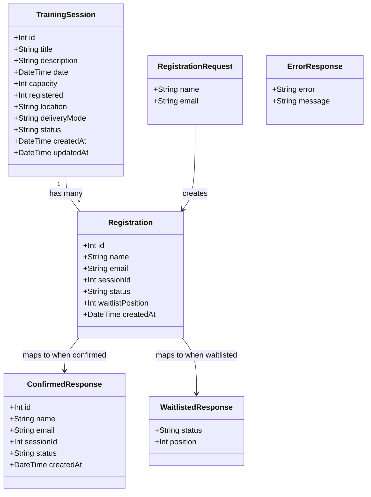

# Waitlist When Training Session Is Full

## Requirements

Implement waitlist functionality for full training sessions, enabling employees to join a waitlist when a session reaches capacity. The system must distinguish between confirmed and waitlisted registrations, track waitlist position, and provide appropriate feedback for both scenarios.

## Entities

## Approach

1. **API Design**:
   - Extend existing `POST /api/training-sessions/:id/registrations` endpoint
   - Return HTTP 201 with registration details when session has capacity
   - Return HTTP 202 with `{ status: "waitlisted", position: N }` when session is full
   - Return HTTP 400 for missing required fields
   - Return HTTP 404 for non-existent session

2. **Data Persistence**:
   - Add `status` field to `Registration` model with default value `"confirmed"`
   - Add `waitlistPosition` field to `Registration` model (nullable, set when waitlisted)
   - Maintain denormalized `registered` counter on `TrainingSession` for O(1) capacity checks
   - Use Prisma interactive transactions for atomic registration creation

3. **Waitlist Logic**:
   - When `registered < capacity`: create registration with status `confirmed`, increment `registered` count
   - When `registered >= capacity`: create registration with status `waitlisted`, compute position as count of existing waitlisted registrations + 1, do not increment `registered` count

4. **Frontend Integration**:
   - Show "Register" button when session has capacity
   - Show "Join Waitlist" button when session is full
   - Display confirmation message for confirmed registrations
   - Display waitlist message with position for waitlisted registrations

## Structure

### Inheritance Relationships
1. `Registration` model extends Prisma base model with status field
2. `ErrorResponse` interface defines standard error response shape

### Dependencies
1. `training-sessions.ts` route depends on `registrationService`
2. `registrationService` depends on `prisma` client
3. `TrainingSessionCard` component depends on API endpoint for registration

### Layered Architecture
1. **Route Layer** (`api/src/routes/training-sessions.ts`): HTTP request handling, status code mapping (201 vs 202)
2. **Service Layer** (`api/src/services/registrationService.ts`): Business logic, validation, waitlist logic, transaction management
3. **Data Access Layer** (`api/src/lib/prisma.ts`): Prisma client for database operations
4. **Frontend Component Layer** (`app/src/components/TrainingSessionCard.tsx`): UI form, state management, API calls

## Operations

### Update Prisma Schema - Add Status and WaitlistPosition to Registration
1. Responsibility: Extend Registration model with waitlist support
2. Attributes:
   - status: String - Registration status (confirmed, waitlisted, cancelled), default "confirmed"
   - waitlistPosition: Int? - Position in waitlist (null for confirmed registrations)
3. Methods: N/A (schema definition)
4. Constraints: Default value "confirmed" for status, nullable waitlistPosition

### Update Service - registrationService.ts
1. Interface Definition: `registerForSession(sessionId: number, name: string, email: string): Promise<Registration | WaitlistedResult>`
2. Core Methods:
   - `registerForSession(sessionId: number, name: string, email: string)`
     - Input Validation: Check name and email are non-empty strings, max 255 chars
     - Business Logic:
       1. Validate input fields (name, email present and within length limits)
       2. Start Prisma interactive transaction
       3. Fetch session by ID within transaction
       4. If session not found, throw NotFoundError (maps to 404)
       5. If session.registered < session.capacity:
          - Create Registration with status "confirmed"
          - Increment session.registered by 1
          - Return registration with status "confirmed"
       6. If session.registered >= session.capacity:
          - Count existing waitlisted registrations for this session
          - Position = count + 1
          - Create Registration with status "waitlisted" and waitlistPosition
          - Return { status: "waitlisted", position: N }
       7. Commit transaction
     - Exception Handling: Transaction rollback on any error
     - Return Value: Registration object or WaitlistedResult
3. Dependency Injection: Prisma client
4. Transaction Management: `prisma.$transaction(async (tx) => { ... })`

### Update Route - training-sessions.ts
1. Responsibility: Handle both confirmed and waitlisted responses
2. Methods:
   - `POST /:id/registrations`
     - Logic:
       1. Parse sessionId from req.params.id
       2. Extract name and email from req.body
       3. Call registrationService.registerForSession(sessionId, name, email)
       4. If result has status "confirmed": return 201 with registration details
       5. If result has status "waitlisted": return 202 with { status: "waitlisted", position: N }
       6. On NotFoundError: return 404 with ErrorResponse
       7. On ValidationError: return 400 with ErrorResponse
3. Annotations: Express router POST method
4. Constraints: Distinguish between confirmed and waitlisted responses

### Update Frontend - TrainingSessionCard.tsx
1. Responsibility: Show appropriate button based on capacity and handle both responses
2. Attributes:
   - showForm: boolean - Toggle form visibility
   - name: string - Employee name input
   - email: string - Employee email input
   - loading: boolean - Submit loading state
   - message: string - Success/error message
   - isWaitlisted: boolean - Whether last submission was waitlisted
3. Methods:
   - `handleSubmit(e: React.FormEvent): Promise<void>`
     - Logic:
       1. Prevent default form submission
       2. Set loading to true
       3. POST to `/api/training-sessions/${session.id}/registrations` with { name, email }
       4. On 201: show "Registration successful!" message, increment local registered count, hide form
       5. On 202: show "You are waitlisted at position N" message, hide form
       6. On error: show error message from response
       7. Set loading to false
4. Constraints: Show "Register" button when not full, "Join Waitlist" when full

## Norms

1. **Annotation Standards**: Use Express router decorators for route definitions
2. **Dependency Injection**: Import prisma client from `../lib/prisma`
3. **Exception Handling**:
   - Custom error classes: `NotFoundError`, `ValidationError`
   - Each error class includes appropriate HTTP status code
   - Unified error response format: `{ error: string, message: string }`
4. **Data Validation**:
   - Required fields: name, email
   - Max length: 255 characters for both fields
   - Type checking: string type validation
5. **Logging**: Use `console.error` for server-side error logging
6. **Documentation Standards**: JSDoc comments for service methods

## Safeguards

1. **Functional Constraints**:
   - Confirmed registration only when `registered < capacity`
   - Waitlisted registration when `registered >= capacity`
   - Waitlisted registrations do not increment `registered` count
   - Both name and email are required fields
   - Maximum 255 characters for name and email

2. **Performance Constraints**:
   - Capacity check must be O(1) using denormalized counter
   - Waitlist position computation uses COUNT query (acceptable for small waitlists)
   - Transaction duration should be minimal

3. **Security Constraints**:
   - Input sanitization for name and email fields
   - No SQL injection via Prisma parameterized queries
   - Error messages must not expose internal system details

4. **Integration Constraints**:
   - Follow existing Express router patterns
   - Maintain backward compatibility with existing GET endpoints
   - Frontend must handle HTTP status codes (201, 202, 400, 404)

5. **Business Rule Constraints**:
   - Session must exist before registration
   - Status must be either "confirmed" or "waitlisted"
   - Waitlist position must be >= 1 for waitlisted registrations
   - Confirmed registrations must have null waitlistPosition

6. **Exception Handling Constraints**:
   - All database errors must trigger transaction rollback
   - HTTP status codes must match response types (201 confirmed, 202 waitlisted, 400 validation, 404 not found)
   - Error responses must follow consistent format

7. **Technical Constraints**:
   - SQLite database with Prisma ORM
   - Express.js for API routing
   - React with TypeScript for frontend
   - No authentication required (out of scope)

8. **Data Constraints**:
   - name: string, required, max 255 chars
   - email: string, required, max 255 chars
   - status: string, enum ["confirmed", "waitlisted", "cancelled"], default "confirmed"
   - waitlistPosition: integer, nullable, >= 1 when status is "waitlisted"

9. **API Constraints**:
   - Endpoint: `POST /api/training-sessions/:id/registrations`
   - Request body: `{ "name": string, "email": string }`
   - Confirmed response: 201 with registration details
   - Waitlisted response: 202 with `{ status: "waitlisted", position: N }`
   - Error responses: 400, 404 with ErrorResponse
